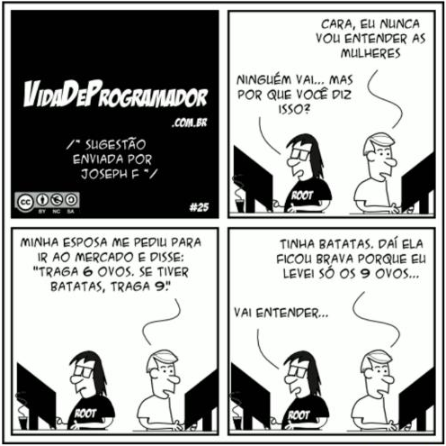

Universidade Tecnológica Federal do Paraná  
Campus Guarapuava  
Curso de Sistemas para Internet  
Professor Eleandro Maschio  
Fundamentos de Programação

# Exercícios: Expressões Booleanas e Estrutura Condicional if-else

## Importante

Enfoque a modelagem e consequente interação com a interface dos objetos. Nenhuma instrução de saída deve ser utilizada nas classes de modelagem. Os exercícios 1 e 6 são teóricos.

## Exercício 1

EXPRESSÕES – Dê o resultado das expressões booleanas abaixo (true ou false):

(a) `!(numerador == denominador)`  
(b) `!(senha.length == 0)`  
(c) `(senha == confirmacao) && !(senha.length == 0)`  
(d) `nota >= 6.0 && percentualFaltas <= 0.25`  
(e) `cotacaoDolar < cotacaoEuro || cotacaoLibra < cotacaoEuro`  
(f) `(qtde < qtdeMaxima) && (saldo > 0 || credito > 0)`

Considere:

- numerador = 2
- denominador = 4
- senha = "abc"
- confirmacao = "123"
- nota = 9.0
- percentualFaltas = 0.05
- cotacaoDolar = 6.0
- cotacaoEuro = 7.0
- cotacaoLibra = 8.0
- qtde = 0
- qtdeMaxima = 10
- saldo = 0.0
- credito = 999.0

As expressões podem ser testadas na linguagem e o resultado impresso.

## Exercício 2

MAIORIDADE – Modele uma classe que represente um indivíduo. Implemente um método que determine se a maioridade já foi atingida.

## Exercício 3

ELEITOR – Modele uma classe que represente um eleitor. Implemente de um método que determine se o voto é: obrigatório, facultativo ou não permitido.

## Exercício 4

ALUNO – Considere um objeto que represente um aluno de Ensino Médio, abstraindo as notas de dois semestres e da avaliação de exame. Implemente métodos que retornem (proibido Math.max()):

(a) a maior nota, considerando os dois semestres;  
(b) a maior nota, considerando também a avaliação de exame.

## Exercício 5

ACADÊMICO – Implemente uma classe que abstraia um acadêmico, considerando a nota final e a frequência, obrigatoriamente informados no construtor. A frequência é um número real entre 0,0 e 1,0 (onde 0,8 corresponde a uma frequência de 80%).

Disponha de um método que retorne a situação desse aluno (em termos de “Aprovado”, “Reprovado” e “Sem Presença Obrigatória”), diante dos requisitos:

- Para aprovação: nota maior ou igual a 6,0 e frequência mínima de 75%;
- Para cursar a disciplina sem presença obrigatória: reprovado com nota maior ou igual a 4,0 e com frequência mínima de 75%.

## Exercício 6

TESTE DE MESA – Considere o seguinte trecho de código, implementado em TypeScript. Qual é o valor de aux ao final da execução?

```typescript
let a = 8, b = 16, c = 4, aux = 0;
if (a > b)
{
aux = a;
a = b;
b = aux;
}
if (b > c)
{
aux = b;
b = c;
c = aux;
if (a > b)
{
aux = a;
a = b;
b = aux;
}
}
```

(a) 0  
(b) 4  
(c) 8  
(d) 16  
(e) ocorre erro de compilação

## Exercício 7

CAIXA SECRETA – Modele uma classe que represente uma caixa secreta. Para a instanciação de um objeto, a classe dispõe de um único construtor que requer, como parâmetros, uma senha alfanumérica e um segredo a ser guardado (ambos são cadeias de caracteres). Tanto a senha quanto o segredo não podem ser alterados (set) e nem recuperados (get) pela interface do objeto. Entretanto, deve ser provido um método que tente abrir a caixa, por meio de outra senha informada como parâmetro. Caso as duas senhas sejam iguais, a caixa deve retornar o segredo. Do contrário, a mensagem “Tente novamente!” deve ser retornada.

## Exercício 8

IMPOSTO DE RENDA – As regras do IRPF do Brasil estão em constante debate e alteração. Sempre existem detalhes que adicionam complexidade ao cálculo do imposto devido. Uma forma para começar a entender (e implementar!) sobre o assunto pode ser modelar o imposto de países com regras mais simples. A Inglaterra, por exemplo, utiliza quatro faixas de alíquotas, que variam conforme o rendimento anual do contribuinte (CORTÊS, 2025), sendo:

| Faixa | Rendimentos Tributáveis | Taxa de Imposto |
| --- | --- | --- |
| Personal Allowance | Até £12.570 | 0% |
| Basic rate | De £12.571 a £50.270 | 20% |
| Higher rate | De £50.271 a £125.140 | 40% |
| Additional rate | Acima de £125.140 | 45% |

Conforme a tabela, uma pessoa com ganho anual de £100 mil pagará 40% de imposto de renda. Entretanto, os primeiros £12.570 de qualquer pessoa são isentos de imposto. Assim, o cálculo para uma pessoa solteira que tenha renda anual bruta de £18,2 mil e não recebe subsídios especiais será feito desta forma:

| | |
| --- | --- |
| Rendimento tributável anual total | £18.200 |
| Personal Allowance | (-) £12.570 |
| Valor da renda tributável | £5.630 |
| Cálculo da obrigação fiscal | £5.630 x 20% |
| Imposto devido | £1.124,20 |

Com base nessas regras, implemente uma classe para a qual seja informada a base de cálculo (anual) de um contribuinte. A classe deve prover métodos para retornar a alíquota e o valor do imposto devido. Revise a resolução diante do princípio da responsabilidade única.

## Exercício 9

GENTÍLICO – Modele e implemente uma classe que resolva o problema de retornar o gentílico de um estado a partir da respectiva sigla de unidade federativa (UF). Por exemplo, para "PR" deve-se retornar “paranaense”. Considere todos os estados brasileiros, além de possíveis variações entre minúsculas e maiúsculas.

## Exercício 10

Aprimore o uso do return no seguinte método. É possível manter a legibilidade e resumir o bloco de instruções a uma única linha.

```typescript
public isEven(): boolean {
  if (this.n % 2 == 0) {
    return true;
  } else {
    return false;
  }
}
```

## Bônus!



Fonte: Noel (2011)

## Referências

CORTÊS, Andrea. Imposto de Renda na Inglaterra: guia para declarar em 2025. 2025. Disponível em: https://www.eurodicas.com.br/imposto-de-renda-na-inglaterra/. Acesso em: 6 out. 2025.

NOEL, André. Vida de Programador: lógica de programação. 2011. Disponível em: https://vidadeprogramador.com.br/2011/03/22/logica-de-programacao/. Acesso em: 19 mar. 2021.

## Como Citar

Todos os exercícios desta lista são autorais.

MASCHIO, Eleandro. Exercícios: Expressões Booleanas e Estrutura Condicional if-else. Guarapuava: Universidade Tecnológica Federal do Paraná, 2025. 4 p. Material didático da disciplina de Fundamentos de Programação.
